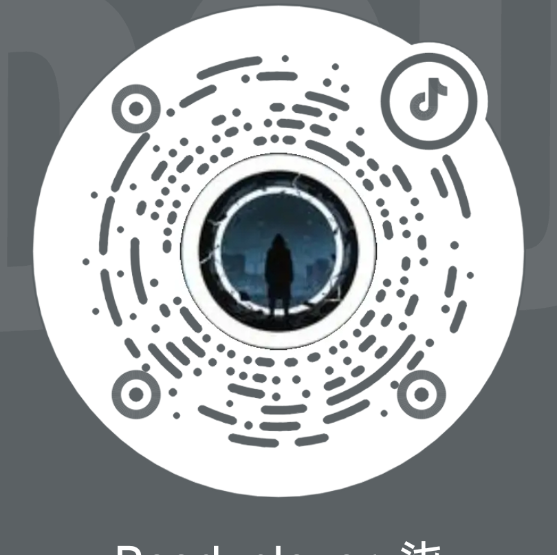

# 大肥鱼 · Live2D 桌宠（个人向修改版）

**当前版本：v1.2.0**（2026-10-28）· 模型与动画仍为 v1.1.0 高清包


> ⚠️ **本作品仅供个人非商业使用。** 美术素材版权归原作者，商业使用需单独授权。

> 基于 [DS鲸鱼娘](https://space.bilibili.com/11272072) 的非商业个人改版。
> 台词改为“女儿”口吻、动作重映射、全部动画高清化到 1280×720。

**本版修改：ReadyPlayer_柒（2026）**



抖音号：**28672646215** · 扫码或搜索找到我

个人爱好作品，非商业使用。

## 她是什么

一个会陪着爸爸干活的鲸鱼小女儿：

- 爸爸开始任务 → “爸爸开始忙啦”
- 推进中 → “爸爸在忙，我安静等”
- 需要确认 → “爸爸，需要你看一下”（动作：东张西望）
- 完成 → “爸爸，做完啦！”（动作：开心跃动）
- 出错 → “爸爸，好像出错了”（动作：害羞惊讶）

还会记：

- 每天第一次完成：“爸爸，今天第一次搞定”
- 每完成 10 次：“爸爸，这是第 10 次啦”
- 每天第一次见面：“今天是第 3 天陪爸爸”

## 许可（重要）

| 内容 | 许可 |
|---|---|
| 美术素材（模型 / 贴图 / 动画） | **CC BY-NC-SA 4.0**（署名 · 非商业 · 相同方式共享） |
| 本版修改说明 | 见 `NOTICE.md` |
| 脚本（`tools/`） | MIT |

**禁止商业使用。** 转载必须保留三位原作者的署名。

## 目录

```
pet/ds-whale-girl/     模型 + 配置（NC-SA）
config/                工作状态台词、人设、动作映射（可直接抄）
tools/                 超分脚本、成长记脚本（MIT）
release/               高清动画包的打包说明
NOTICE.md              署名链 + 修改清单
LICENSE                CC BY-NC-SA 4.0 全文（主协议）
licenses/MIT.txt       代码部分（MIT）
```

## 安装

### 1. 装插件

```bash
# 按 dsh-pet-live2d 的说明安装插件
https://github.com/A8Chann/dsh-pet-live2d
```

### 2. 放模型

把 `pet/ds-whale-girl/` 复制到：

```
~/.dsh/pets/ds-whale-girl/
```

### 3. 配台词与动作

参考 `config/` 里的三个片段，合并进 `~/.dsh/dsh-pet/main-config.jsonc`：

- `whisperPrompt`（人设）
- `workStatusTexts`（六档工作状态台词）
- `animations.events.workStatus`（六档动作）

### 4. 高清动画（可选）

把 `release/webm-1280/` 里的 106 个 `webm` 覆盖到：

```
~/.dsh/profiles/desktop/node_modules/dsh-pet/assets/webm/
```

然后重启 DSH。

## 推荐音色

配合 MiniMax 预设音色 **憨憨萌兽**（`Chinese (Mandarin)_Cute_Spirit`）效果最好——
清脆、带一点兽感，贴近角色设定。在本地 TTS 配置里把 `voice` 改成这个 ID 即可。

## 可选增强：隐藏 / 退出 / 快捷键

装好后跑一次（**插件更新后需要重跑**）：

```bash
# macOS / Linux
bash tools/patch-pet-menu.sh

# Windows（右键 → 使用 PowerShell 运行）
tools\patch-pet-menu.ps1
```

加上这些：

| 能力 | 用法 |
|---|---|
| 隐藏大肥鱼 | 右键菜单；形象消失，**语音继续** |
| 叫回 | macOS `⌥⌘P` / Windows `Ctrl+Alt+P`，或点托盘图标 |
| 退出桌宠 | 右键菜单；真退出（`display` 变为 `none`，进程结束） |
| 辅助提示 | 设置页「显示位置」下方标出「都不显示」= 关闭桌宠 |

退出后想再叫回来：**设置 → 桌宠配置 → 显示位置 → 仅桌面 → 保存**。

## 资源占用

| 项 | 数值 |
|---|---|
| 磁盘 | 约 **425 MB**（106 个 1280×720 动画） |
| 内存 | 约 **500–600 MB**（Electron + 视频解码的固有开销） |
| 与 360p 原版相比 | 内存 **+约 92 MB**，磁盘 +373 MB |

> 桌宠本身是 Electron 应用 + 透明视频解码，内存占用主要来自运行环境，高清素材只占增量的一部分。
> 建议 **8 GB 内存以上**的机器使用；低配机器可能出现卡顿。
> 需要更省资源的话，可自行用原版 640×360 素材替换 `webm/` 目录。

## Windows 安装

把路径里的 `~/.dsh/` 换成 `%USERPROFILE%\.dsh\`：

| 用途 | macOS | Windows |
|---|---|---|
| 模型目录 | `~/.dsh/pets/ds-whale-girl/` | `%USERPROFILE%\.dsh\pets\ds-whale-girl\` |
| 主配置 | `~/.dsh/dsh-pet/main-config.jsonc` | `%USERPROFILE%\.dsh\dsh-pet\main-config.jsonc` |
| 高清动画 | `~/.dsh/profiles/desktop/node_modules/dsh-pet/assets/webm/` | `%USERPROFILE%\.dsh\profiles\desktop\node_modules\dsh-pet\assets\webm\` |

### 兼容性

| 平台 | webm + alpha | 说明 |
|---|---|---|
| Windows Chrome / Edge | ✅ | 直接播放 |
| Windows Electron（桌面模式） | ✅ | 直接播放 |
| macOS Chrome / Electron | ✅ | 直接播放 |
| macOS Safari | ❌ | 不认 webm alpha，会显示黑底 |

> **Windows 未实测。** 本版主要在 macOS 上验证；Windows 的路径大小写、配置合并可能有问题，遇到请在 Issues 反馈。

## 上游更新

本仓库是衍生作品，**不是 fork**，上游更新不会自动同步。
跟进流程见 [UPSTREAM.md](UPSTREAM.md)。

## 高清化说明

原动画是 640×360 预渲染视频，在 Retina 屏上被放大 1.9 倍，所以显糊。

本版用 Real-ESRGAN（anime 6B）逐帧超分到 1280×720，**保留 alpha 通道**，再以 VP9 重编码。

- 每个动作约 241 帧，单帧约 1.16 秒（M5 MPS）
- 106 个动作约 8 小时
- 输出体积从 52MB 增至 425MB

自定义脚本：`tools/upscale_pet.py`（用法见文件头）。

## 已知限制

- 只支持桌面模式（desktop）；浏览器模式需要 Live2D 渲染器
- 高清包较大（425MB），建议走 GitHub Release 而不是直接进仓库
- Windows 上的缩放/DPI 表现未测试
